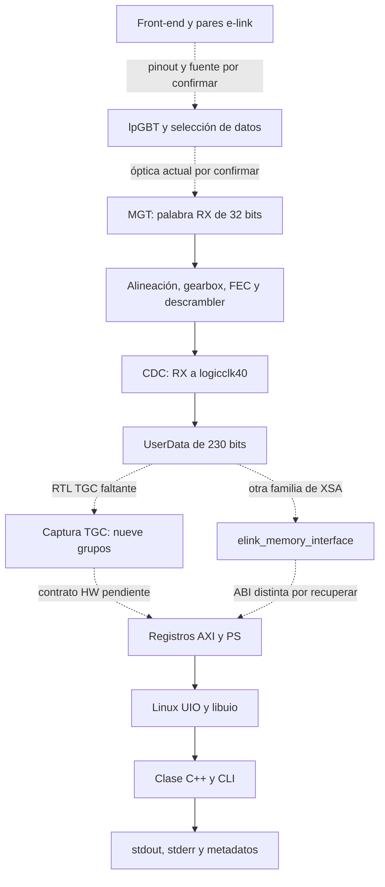

# Sistema: dos mitades trazadas y una unión pendiente

[Inicio](START_HERE.md) · [Rutas y evidencias B/R/X](TOOL_AND_PATH_ATLAS.md)

**VERIFICADO** significa implementación o bytes inspeccionados. **INFERIDO** es una explicación aún no medida. **CONTRADICTORIO** identifica contratos incompatibles. **DESCONOCIDO** exige evidencia adicional. Ninguna marca certifica el equipo actual.

## Cadena de adquisición

Flechas continuas: recorrido acreditado por fuentes de una variante; no prueba de integración de todas las variantes. Cada nodo se respalda en la tabla siguiente. Las rutas R enlazan al repositorio; las B y X son relativas al respaldo y se localizan en el atlas.

| Etapa | Entrada → salida / transformación | Reloj, interfaz y fuente exacta | Comprobación y laguna |
|---|---|---|---|
| FE | Magnitud/estímulo → palabras eléctricas e-link | [R07: notas de FE](TOOL_AND_PATH_ATLAS.md#r07); firmware y protocolo FE no recuperados | Medición física independiente y pinout aprobado; no deducir el pinout desde Linux |
| lpGBT | ePortRx o fuente interna → trama óptica | [B07: mapas V0/V1](TOOL_AND_PATH_ATLAS.md#b07); [manual PiGBT](https://pigbt.web.cern.ch/manual/configuration.html) | Confirmar modo real, Serializer y fuentes por grupo. Lock permite también PRBS/loopback |
| MGT | Óptica → palabra paralela RX de 32 bits y reloj RX | [R01: BD](TOOL_AND_PATH_ATLAS.md#r01), nets `CH10_MGT_USRWORD_o` y `CH10_MGT_RXUSRCLK_o` | Número 10 es ejemplo de net trazada; no asignación actual del FE |
| Core uplink | Palabras → frame alineado de 256 bits → usuario/EC/IC | [R02](TOOL_AND_PATH_ATLAS.md#r02), `lpgbtfpga_uplink.vhd:263–325,404–524` | Header aligner, bitslip, gearbox, deinterleaver, FEC, descrambler. No decodifica eventos FE |
| CDC | 234 bits en dominio RX → 234 bits en `logicclk40` | [R03](TOOL_AND_PATH_ATLAS.md#r03), `emp_lpgbt.vhd:473–498`, `cdc_rx.vhd:150–218` | Relación declarada 8; no FIFO genérica para Linux. Observar strobe y progreso antes/después del CDC |
| UserData | Separación `[229:0]`, EC `[231:230]`, IC `[233:232]` | [R03](TOOL_AND_PATH_ATLAS.md#r03), líneas 495–498 | FEC5/10G24 de esta fuente; ancho del bus no prueba cuántos bits FE están conectados |
| Capturador TGC | UserData → `data_group_0..8` y header | [B01/B02](TOOL_AND_PATH_ATLAS.md#b01), [R04: JSON](TOOL_AND_PATH_ATLAS.md#r04); declaración DT en [R06](TOOL_AND_PATH_ATLAS.md#r06) | DESCONOCIDO: RTL, packing, trigger, rearme, reloj AXI, retención, coherencia y efectos de lectura |
| Interfaz alternativa | UserData → `elink_memory_interfa_0` | [X01](TOOL_AND_PATH_ATLAS.md#x01): HWH xV23 conecta pipeline 11; AXI declarado a 99.999001 MHz | VERIFICADO en ese XSA; no equiparar a TGC ni a `eLink_Interface_v1` por semejanza |
| AXI/PS/Linux | Acceso del PS → slave PL descrito en DT → UIO | [R01](TOOL_AND_PATH_ATLAS.md#r01), [B03](TOOL_AND_PATH_ATLAS.md#b03), [B09](TOOL_AND_PATH_ATLAS.md#b09) | DT y sysfs describen el mapa; no prueban respuesta AXI, reloj o reset |
| C++ → MMIO | Nombre → `open`/`mmap` → carga `volatile uint32_t` | [B01–B03](TOOL_AND_PATH_ATLAS.md#b01) | Cotejar ELF, libuio y mapa; comprobar retorno/errores. `volatile` no crea un snapshot |
| Salida | Palabras → etiquetas hexadecimales | [B01](TOOL_AND_PATH_ATLAS.md#b01), CLI:11–64; [R08: supervisor](TOOL_AND_PATH_ATLAS.md#r08) | Guardar stdout/stderr, retorno y tiempos de software. No son timestamps del frame |

## Versiones incompatibles

Direcciones **para comparar archivos**, no comandos de acceso.

| Artefacto | SoC y canales IC | `0xA00D0000` | `0xA00E0000` | Qué cambia |
|---|---|---|---|---|
| R01: `emp_fw_TE0807.bd` | XCZU4EG; 0–11 | `axi_intc_1`, 64 KiB | `axi_intc_2`, 64 KiB | No contiene capturador TGC |
| X01: `trenz-xV23-03-00-00/hw_desc.xsa` | XCZU4EG; 0–12 | `elink_memory_interfa_0`, 16 KiB | No hay MEMRANGE declarado allí | Interfaz conectada al UserData de `emp_lpgbt_11`; debughub en B0000000 |
| X02: `emp-xV23-01-00-00/hw_desc.xsa` | XCZU4EG; 0–12 | La misma instancia/tamaño | No hay MEMRANGE declarado allí | HWH similar; no significa mismo bitstream o placa |
| X03: Trenz `02-00-00`, `02-00-01`; EMP `01-00-00` | XCZU4EG; 0–11 | Sin MEMRANGE de esa interfaz | Sin MEMRANGE de esa interfaz | Interfaz e-link en A00C0000; ejemplos conectados al pipeline 10 |
| X04: Trenz `01-00-00`, Enclustra `00-00-00` | XCZU4EG / XCZU4CG | No aplicar mapa A00D | No aplicar mapa A00E | Familia anterior con ventanas 0x800…; no es Zynq-7000 |
| R06: `out_lpgbt_10_cd`, `dd`, `direct` / `pl.dtsi` | Declaran `emp_lpgbt_0..12` | `Read_PRBS_regs`, 16 KiB | `tgc_readUplink_regs`, 16 KiB | Coinciden con bases de scripts, pero DT no prueba RTL ni firmware activo |

Los tres overlays R06 **sí existen en main**, aunque no están en este TAR. Sus nombres de firmware difieren; no se sabe qué significan operativamente `cd`, `dd` y `direct` sin el diseño asociado. Su existencia reduce la búsqueda: son candidatos a relacionar con el equipo, nunca permiso para cargarlos.

## Registro físico, offset y registro remoto

Para el periférico validado: `dirección física = base del periférico + offset del registro`. En la biblioteca: `puntero virtual = mmap + offset sysfs del mapa + offset del registro`. El offset pasado a `mmap` selecciona el mapa UIO mediante `n × tamaño_de_página`; no es la dirección física. [Linux UIO HOWTO](https://docs.kernel.org/driver-api/uio-howto.html).

Ejemplo **aritmético, no dirección autorizada**: base histórica A00E0000 + grupo 5, offset 0x18 = A00E0018. La API `uio_read32` recibe `24` bytes, no índice `6`. El número `/dev/uioN` no es el canal MGT.

Una dirección como `ULDATASOURCE0` del chip es otro espacio: la CPU la escribe en el **controlador IC**, que envía una transacción al lpGBT. No se suma directamente a la base del capturador.

## Qué significa cada palabra del lector TGC

| Campo impreso | Offset | Significado verificable | Significado pendiente |
|---|---|---|---|
| `magic` | 0x00 | Getter de 32 bits; la CLI no compara firma | Valor de firma del capturador y versión ABI. `0x656D7049` pertenece al controlador IC, no acredita TGC |
| `data_group_g`, g=0…8 | `0x04+4g` | Nueve lecturas independientes de 32 bits | Qué bits/e-link/evento representa cada palabra; orden y padding |
| `data_header` | 0x28 | Un registro de 32 bits, solo impreso | Si es estado, checker o header; no asumir cabecera física ni contador |
| `clk_thresh` | 0x2C | Registro de 32 bits; clase ofrece lectura/escritura, CLI solo lectura | Unidad, dominio, latencia y relación con el trigger. No es un programador del Si5345 |
| Línea decimal final | — | Repite `clk_thresh` | No es un registro adicional |
| Línea del constructor | — | Major/minor del dispositivo Linux | No identifica canal ni dato FE |

La declaración JSON R04 (revisión 27) y B02 coinciden en offsets. Eso acredita el **contrato esperado por software**, no sus efectos en la FPGA. El registro `data_groups` de R05, único en +0x04 y escribible, es otra API. `ReadPRBS` usa +0x04 control, +0x08 status y +0x0C data; tampoco es intercambiable.

## Recorrido que debes poder explicar

`main` B01:21 → constructor B02:25 → `uio_find_by_uio_name` B03 → `uio_open_fix` B03:344 → `readDataGroup0Value` B02:65 → `uio_read32(map0,4)` B03 `mem.c:209` → máscara B02:297 → `print_hex32` B01:11.

La operación MMIO está en `*val = *(volatile uint32_t *) ptr`, `mem.c:219`. No hay espera IRQ ni bucle de adquisición en esta CLI. La clase no valida índices, límites o coherencia por medio de libuio; la identidad del mapa debe cerrarse antes.

## Estados que no equivalen a datos

`fwMonitor` lee siete campos de tres registros; la tabla presenta `RX locked`, `TX ready`, `TX aligned` y el AND `XCVR Ready`. En el RTL R03, `RX locked` procede de alineación de cabecera; `uplinkReady_o` procede de `cdc_rx_ready`. Son señales diferentes. Los campos de relojes leídos no aparecen en la tabla; tampoco hay contador de frames/FEC en esa salida.

El `ready` del CDC se pone a 1 después de observar strobe y no se borra solo porque falten strobes posteriores; sí puede borrarse por el reset derivado del core. Por tanto no es un contador de frescura ni una explicación demostrada del fallo histórico.
