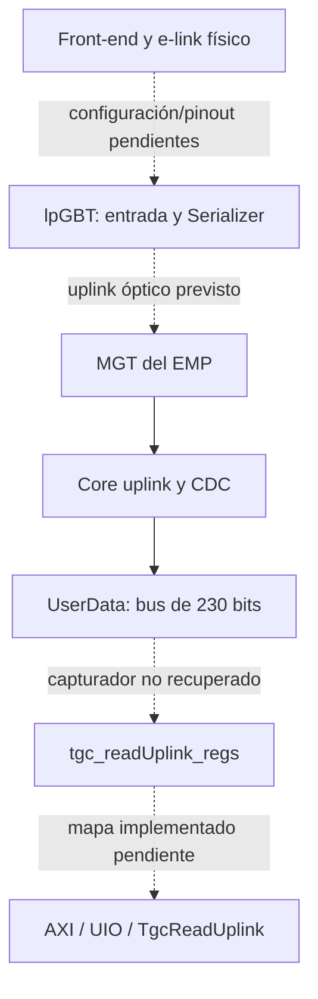
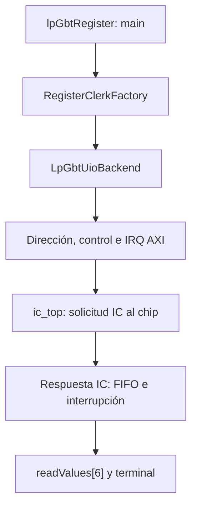

# Mapa técnico: dónde termina la evidencia

Entrada operacional: [guía de campo](00_GUIA_CAMPO.md). Referencias F1–F12: apéndice de esa guía. [Registro trazable de fuentes](08_FUENTES.md).

## Cuatro capas de certeza

| Capa | Lo que sabemos | Lo que no debe concluirse |
|---|---|---|
| Arquitectura diseñada | FE, lpGBT, óptica, EMP; separación entre payload y control IC | Que toda esa ruta esté desplegada. |
| Código implementado | Core uplink, CDC, registros IC, debughub, accesos UIO y CLI de lectura | Que las fuentes se compilaron juntas o pertenecen al bitstream activo. |
| Observación histórica | Loopback interno con patrones recuperados; pruebas de cable/FE con discrepancias | Que hubo adquisición FE íntegra y sin pérdida. |
| Hardware actual | DESCONOCIDO; pendiente de inventario y prueba local | Nada sobre firmware, lock, fuente o funcionamiento actual. |

## Hardware y camino diseñado

Intuición: el lpGBT concentra señales eléctricas del FE en una transmisión óptica. El EMP recupera esos bits, reconstruye el protocolo y ofrece buses internos a la lógica. Linux necesita un periférico adicional que transforme ese bus en información consultable. El controlador IC no cumple esa función de payload.

Las flechas continuas representan conexiones verificadas en fuentes RTL, no mediciones actuales. Las discontinuas indican eslabones no demostrados para la build de lectura. El tramo físico procede del diseño/notas; no se ha verificado el cableado actual. F5/F7.

**Modelo de FPGA:** el BD `emp_fw_TE0807.bd` declara `xczu4eg-fbvb900-1-e`, Vivado 2023.2 y PS `zynq_ultra_ps_e_0`. No es evidencia de una Zynq-7000 TE0715 en este experimento. El nombre Trenz abarca plataformas distintas; confirmar la placa actual. Los modelos físicos de FE/EMCI y el pinout del cable quedan pendientes. [BD, `design.design_info`, F7]

**Velocidades:** las notas describen downlink óptico 2.56 Gb/s, 64 bits/frame; uplink 10.24 Gb/s. La implementación `lpgbtFpga_10g24` selecciona `DATARATE_10G24`; `emp_lpgbt.vhd` fija FEC5. Son hechos estáticos de esa variante. No equivalen a la configuración del chip ni a tasas e-link actuales. Las pruebas usan etiquetas 320/640/1280 para la configuración de e-links; no son tasas ópticas. F5/F7.

## Un dato, desde FE hasta C++

| Tramo | Señales / operación | Reloj o almacenamiento | Evidencia y límite |
|---|---|---|---|
| FE → lpGBT | Pares diferenciales de datos hacia/desde FE y reloj hacia FE | Tasa/fase e-link y habilitación pendientes | Diseño descrito en `1013`; pinout y firmware FE no recuperados. DESCONOCIDO para el sistema actual. |
| lpGBT → óptica | Serializer en modo normal, fuentes externas habilitadas | Uplink según modo del chip | Las notas también usan Serializer en loopback. La selección vigente no está demostrada. |
| MGT → wrapper | `CH10_MGT_USRWORD_o` → `emp_lpgbt_10/MGT_USRWORD_i`; `CH10_MGT_RXUSRCLK_o` → `MGT_RXUSRCLK_i` | Palabras de 32 bits, dominio RX del MGT | Nets explícitas del BD. Canal 10 es ejemplo trazado, no selección recomendada para la placa actual. |
| Wrapper → core | `uplink_mgtword_s` → `lpgbtFpga_top_inst/uplink_mgtword_i` | Dominio `lpgbtfpga_mgtrxclk_s` | `emp_lpgbt.vhd:421–427,573–610`. |
| Alineación | `mgt_word_i(1 downto 0)` al frame aligner, patrón `01`; `mgt_bitslipCtrl_o` vuelve al MGT | Mismo reloj RX, strobes para límites de frame | `lpgbtfpga_uplink.vhd:263–298`. Se examinan dos bits de cabecera, no «un bit de validación» como sugiere la nota `0916`. |
| Reagrupación | `mgt_word_i` → rxGearbox → frame de 256 bits | Entradas/salidas del gearbox usan `uplinkClk_i`; salida válida por enable | `lpgbtfpga_uplink.vhd:300–325`. El gearbox no implica aquí un cambio físico de reloj a 40 MHz. |
| Recuperación del protocolo | `frame_pipelined_s` → deinterleaver → decoder FEC → descrambler | Core con enable de frame | `lpgbtfpga_uplink.vhd:404–470`. Reordena, corrige y desaleatoriza; no decodifica el protocolo del FE. |
| Campos recuperados | FEC5/10G24: usuario `[229:0]`, EC `[231:230]`, IC `[233:232]` | `uplinkData320`, 234 bits incluyendo EC/IC | `lpgbtfpga_uplink.vhd:492–524`; `lpgbtfpga_10g24.vhd:232–250`. Capacidad del bus no equivale a 230 bits FE conectados. |
| Cruce de reloj | `lpgbtfpga_uplinkData_320` → `cdc_rx` → `lpgbtfpga_uplinkData_40` | RX MGT → `logicclk40`; razón declarada 8; registros de fase/captura | `emp_lpgbt.vhd:473–498`; `cdc_rx.vhd:130–218`. No es una cola de eventos para Linux. |
| Salida usuario | `lpgbtfpga_uplinkUserData_s` → `lpgbtfpga_uplinkUserData_o` | Bus 230 bits a 40 MHz en esta variante | `emp_lpgbt.vhd:430–437,495–498`. |
| Captura AXI | Conexión UserData → `data_group_0..8`, header y threshold | **RTL ausente**: packing, trigger, retención, CDC a AXI y atomicidad desconocidos | JSON y getters disponibles; el BD recuperado no instancia este lector. No se puede completar este eslabón. |
| Registro → variable | `readDataGroup0Value()` → `uio_read32(map0,4,&value)` | Acceso MMIO de CPU a una palabra | Backup `TgcReadUplink.cpp:65–79`; `libuio/mem.c:209–221`. |
| Variable → terminal | `val` → `print_hex32()` → `std::cout` | Una lectura por getter, secuencial | Backup CLI `:11–15,41–49`. Sin timestamp de adquisición ni contador de frame. |

**Posible pérdida de información:** el frontend puede emitir eventos que un muestreo de registros no conserva; un capturador puede sobrescribir datos antes de que Linux lea; registros de varios instantes pueden mezclarse. Estos son límites pendientes de resolver, no fallos medidos de la build actual. En el core recuperado los datos de salida también se fuerzan a cero mientras `rdy_1_s='0'`: cero no permite distinguir por sí solo falta de transporte y payload cero.

## Qué ofrece realmente la FPGA antes del lector experimental

El BD consultado contiene `emp_lpgbt_0..11` y un debughub. El software de monitor y el RTL del debughub incluyen campos hasta canal 12. Esa diferencia de cobertura impide prometer trece canales implementados en ese BD.

| Dirección en el BD recuperado | Instancia | Rango declarado | Comparación con notas |
|---|---|---|---|
| `0xA0000000 + N*0x10000`, N=0..11 | `emp_lpgbt_N` | 16 KiB | Control IC; N=10 está en `0xA00A0000`. |
| `0xA00C0000` | `axi_intc_0` | 64 KiB | No es un lector de payload. |
| `0xA00D0000` | `axi_intc_1` | 64 KiB | En scripts de otro diseño es el generador `Read_PRBS_regs`. **CONTRADICTORIO entre versiones.** |
| `0xA00E0000` | `axi_intc_2` | 64 KiB | En scripts de otro diseño es el lector. **CONTRADICTORIO entre versiones.** |
| `0xA00F0000` | `axi_intc_3` | 64 KiB | En notas de trece lectores sería la instancia 1. |
| `0xB0000000` | `empfw_debughub_0` | 16 KiB | Refuta la generalización de que 0xB sea inválido para esta plataforma. |

Fuente: `design.addressing./zynq_ultra_ps_e_0.address_spaces.Data.segments` del BD. Estas direcciones son para comparar artefactos, **no instrucciones para acceso al hardware actual**.

Hay otra interfaz existente: `eLink_Interface_v1/src/eLink_Interface.vhd`. Tiene `user_data_in(229:0)`, `user_data_out(31:0)`, FIFO TX/RX y mapa propio. Su captura usa los 224 bits bajos y la FIFO RX tiene `rd_en => '1'`. No es `TgcReadUplink`, no aparece instanciada en este BD y no demuestra que el lector de nueve palabras esté desplegado. Su entrada a RX condiciona la escritura con `dlFIFO_full_s`, que merece revisión, pero no se afirma que sea la causa de las anomalías históricas. Foco futuro, sin cambios de código.

## Un comando de payload, desde `main()` hasta MMIO

Ejemplo real: ejecutar el `tgc_readuplink_cli` del respaldo **solo tras el punto de parada P0**.

1. `main()` construye `TgcReadUplink("tgc_readUplink_regs")`. El nombre no se obtiene de un argumento.
2. El constructor llama a `uio_find_by_uio_name()`. `libuio` enumera `/sys/class/uio`, obtiene nombres y retorna la primera coincidencia. No elige por canal del FE.
3. `uio_open()` llama a `uio_open_fix()`: abre el nodo `/dev/uioN` con `O_RDWR` y mapea cada map con `PROT_READ|PROT_WRITE`, `MAP_SHARED`, offset de fichero `i*getpagesize()`.
4. `readDataGroup0Value()` solicita map0 y offset de registro **4 bytes**. No divide ese offset por cuatro en la API.
5. `uio_read32()` calcula `map + maps[0].offset + 4` y ejecuta `*val = *(volatile uint32_t *) ptr`. Esta es la expresión C que accede al hardware. La instrucción ARM concreta depende del binario/compilador; no se ha desensamblado un ELF del sistema.
6. `_isolateBitsForRead(value,32,0)` usa máscara de 64 bits en esta copia y devuelve los 32 bits leídos.
7. `val` se imprime en hexadecimal mediante `print_hex32()`. El destructor cierra/desmapea UIO. No hay espera de IRQ en este recorrido.

Referencias: F1/F2. `uio_read32` solo comprueba punteros `info`/`val`, sin validar índice/tamaño/alineación. El retorno 0 no significa integridad del bus ni del frame; una excepción hardware puede impedir retornar. `mmap` exitoso no ejecuta necesariamente la transacción al slave; la desreferencia posterior sí la solicita.

## Un comando IC, por qué `-r` modifica el controlador

Ejemplo de sintaxis existente, no orden autorizada para inventario: `lpGbtRegister -a lpgbt-uio://emp_lpgbt_N -r REG`.

El parser acepta `-a/--address`, `-r/--read` y `-w/--write`. La dirección por defecto es `emp_lpgbt_9`, por lo que no se debe omitir `-a` por conveniencia. La factory separa `://`; con `HAVE_UIO` elige `LpGbtUioBackend`, y también existe backend `lpgbt-simulator`. Un resultado obtenido con ese backend simulado no acredita hardware.

Al construir el backend se lee `magic`, se escribe configuración inicial de dirección y se fija la dirección de chip `0x70` en el controlador. La lectura de registro escribe su dirección, limpia/habilita IRQ, envía `0x10004` al control, espera IRQ 1 ms, vacía la FIFO con escrituras de avance y deshabilita IRQ. Finalmente retorna `readValues[6]`, sin comprobar aquí que haya siete elementos. No confundir el índice cero-basado con el comentario «posición 7».

| Offset en `emp_lpgbt_N`, copia software | Papel en la transacción |
|---|---|
| `0x00` | `magic`; en el RTL recuperado `0x656D7049`, firma del controlador IC, **no del lector de payload**. |
| `0x04` | `control`: inicia/avanza operaciones y contiene número de bytes según el protocolo implementado. |
| `0x08` | `status`, incluidas condiciones ready/FIFO. |
| `0x0C` / `0x10` | `data_rx` / `data_tx` de IC; no datos de eventos FE. |
| `0x14` / `0x18` | `register_addr` / `lpGBT_addr`. |
| `0x1C` / `0x20` / `0x24` | `interrupt_enable` / `interrupt_flags` / `interrupt_clear`. |

Los offsets proceden de `AxiRegisterDefinitions.h:7–23`. Un offset idéntico en otro periférico puede tener una función completamente distinta. La dirección del registro **dentro del chip** —por ejemplo `ULDATASOURCE0` V1— es otra capa de direccionamiento y no es un offset físico AXI.

## AXI, Device Tree y UIO: intuición para depurar

El Device Tree es el catálogo que Linux recibe del hardware; no es un escáner eléctrico. UIO convierte una entrada de ese catálogo en un nodo y un mmap. AXI transporta la transacción de CPU hacia el periférico PL. El slave debe existir, responder y tener reloj/reset correctos para que esa transacción termine.

En el BD, `M_AXI_HPM0_FPD` alimenta `axi_interconnect_0`, incluido `emp_lpgbt_10/s_axi` por M10. `M_AXI_HPM1_FPD` alimenta `axi_interconnect_1` y el debughub. Esto verifica arquitectura de acceso PS→PL en esa exportación; no verifica accesibilidad actual. En AXI4-Lite, dirección y datos de escritura, respuesta, dirección de lectura y respuesta de lectura son canales distintos. Que una dirección esté en Address Editor no prueba un handshake funcional de lectura.

La modificación de `compatible` a `generic-uio` documentada en `1001` cambia el binding Linux. No repara un diseño sin respuesta. La ruta correcta de depuración es DT ↔ build ↔ Address Editor ↔ slave/reloj/reset, antes de variar direcciones desde `/dev/mem`.

## Dónde faltan piezas

Se ha llegado estáticamente hasta `lpgbtfpga_uplinkUserData_o` y desde `data_group_N` hasta una variable C++. **No se ha unido esas dos mitades.** Falta el RTL y la integración del capturador de la build histórica/activa. Hasta recuperarlos, no se pueden especificar el empaquetado de grupos, significado de header, unidad de `clk_thresh`, condición de actualización, CDC a AXI o atomicidad.

Los `.md` de `20_Documents` consultados para Interaction, Elink y TDR son fichas `to_read` con campos vacíos y referencias a PDFs, no el contenido de esos informes. Esta entrega no atribuye conclusiones técnicas a esos PDFs no leídos. No se ha reconstruido todavía la electrónica analógica ni el protocolo de eventos del FE.
