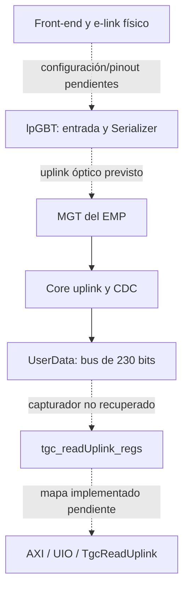
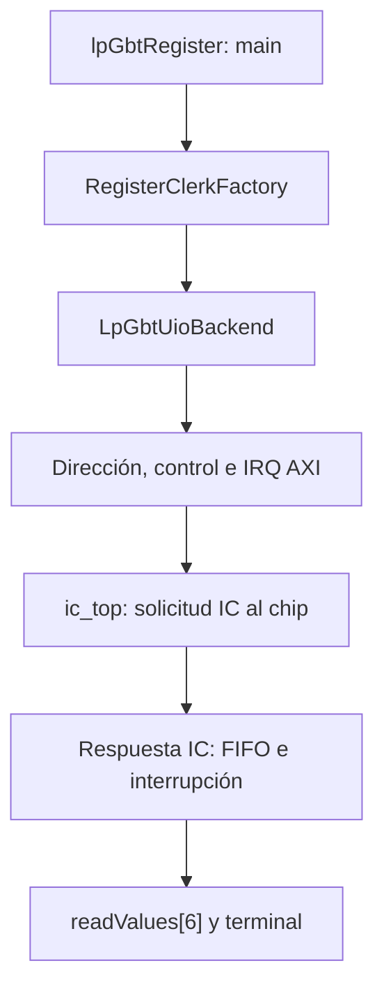

# Mapa técnico: hasta dónde llega lo que sabemos

Para trabajar en la placa, empieza por la [guía de campo](00_GUIA_CAMPO.md); las referencias F1–F12 están al final de esa guía. Cada afirmación tiene su origen en el [registro de fuentes](08_FUENTES.md).

## Cuatro capas de certeza

| Capa | Lo que sabemos | Lo que no se puede concluir |
|---|---|---|
| Arquitectura diseñada | FE, lpGBT, óptica y EMP; payload y control IC van por caminos separados | Que toda esa ruta esté montada. |
| Código implementado | Core uplink, CDC, registros IC, debughub, accesos UIO y CLI de lectura | Que esas fuentes se compilaran juntas o estén en el bitstream cargado. |
| Pruebas anteriores | Loopback interno con patrones recuperados; pruebas de cable y FE con resultados que no cuadran | Que se haya adquirido el FE completo y sin pérdidas. |
| Hardware actual | DESCONOCIDO; falta el inventario y la prueba en la placa | Nada sobre firmware, lock, fuente o funcionamiento actual. |

## Hardware y camino diseñado

La idea: el lpGBT junta las señales eléctricas del FE en un enlace óptico. El EMP recupera esos bits, rehace el protocolo y entrega buses internos a la lógica. Para que Linux pueda leer ese bus hace falta un periférico más, el capturador. El controlador IC no hace ese trabajo.

Las flechas continuas son conexiones que aparecen en el RTL, no mediciones. Las discontinuas son tramos sin confirmar en la build de lectura. El tramo físico sale del diseño y de las notas; el cableado actual no se revisó. F5/F7.

**Modelo de FPGA.** El BD `emp_fw_TE0807.bd` declara `xczu4eg-fbvb900-1-e`, Vivado 2023.2 y el PS `zynq_ultra_ps_e_0`. Eso no apunta a una Zynq-7000 TE0715. «Trenz» abarca varias plataformas, así que confirma la placa. Faltan los modelos del FE y del EMCI y el pinout del cable. [BD, `design.design_info`, F7]

**Velocidades.** Según las notas, el downlink óptico va a 2.56 Gb/s con 64 bits por frame, y el uplink a 10.24 Gb/s. `lpgbtFpga_10g24` selecciona `DATARATE_10G24` y `emp_lpgbt.vhd` fija FEC5. Eso es lo que dice el código de esa variante, no la configuración del chip ni las tasas de los e-links de hoy. Las etiquetas 320/640/1280 de las pruebas son de los e-links, no de la óptica. F5/F7.

## Un dato, desde FE hasta C++

| Tramo | Señales u operación | Reloj o almacenamiento | Fuente y límite |
|---|---|---|---|
| FE → lpGBT | Pares diferenciales de datos con el FE y reloj hacia el FE | Tasa, fase y habilitación del e-link por confirmar | Diseño descrito en `1013`. No se recuperaron el pinout ni el firmware del FE. DESCONOCIDO hoy. |
| lpGBT → óptica | Serializer en modo normal, con fuentes externas habilitadas | Uplink según el modo del chip | Las notas también usan el Serializer en loopback. No sabemos qué está seleccionado. |
| MGT → wrapper | `CH10_MGT_USRWORD_o` → `emp_lpgbt_10/MGT_USRWORD_i`; `CH10_MGT_RXUSRCLK_o` → `MGT_RXUSRCLK_i` | Palabras de 32 bits en el dominio RX del MGT | Nets del BD. El canal 10 es solo el ejemplo que se siguió. |
| Wrapper → core | `uplink_mgtword_s` → `lpgbtFpga_top_inst/uplink_mgtword_i` | Dominio `lpgbtfpga_mgtrxclk_s` | `emp_lpgbt.vhd:421–427,573–610`. |
| Alineación | `mgt_word_i(1 downto 0)` al frame aligner, patrón `01`; `mgt_bitslipCtrl_o` vuelve al MGT | Mismo reloj RX, strobes en los bordes de frame | `lpgbtfpga_uplink.vhd:263–298`. Mira dos bits de cabecera, no «un bit de validación» como dice la nota `0916`. |
| Reagrupación | `mgt_word_i` → rxGearbox → frame de 256 bits | Entrada y salida del gearbox con `uplinkClk_i`; salida válida por enable | `lpgbtfpga_uplink.vhd:300–325`. Aquí el gearbox no cambia el reloj a 40 MHz. |
| Recuperar el protocolo | `frame_pipelined_s` → deinterleaver → decoder FEC → descrambler | Core con enable de frame | `lpgbtfpga_uplink.vhd:404–470`. Reordena, corrige y desaleatoriza. El protocolo del FE se decodifica en otro sitio. |
| Campos | FEC5/10G24: usuario `[229:0]`, EC `[231:230]`, IC `[233:232]` | `uplinkData320`, 234 bits con EC e IC | `lpgbtfpga_uplink.vhd:492–524`; `lpgbtfpga_10g24.vhd:232–250`. Que el bus tenga 230 bits no significa que haya 230 bits del FE conectados. |
| Cruce de reloj | `lpgbtfpga_uplinkData_320` → `cdc_rx` → `lpgbtfpga_uplinkData_40` | RX MGT → `logicclk40`, razón 8, registros de fase y captura | `emp_lpgbt.vhd:473–498`; `cdc_rx.vhd:130–218`. No guarda una cola de eventos para Linux. |
| Salida de usuario | `lpgbtfpga_uplinkUserData_s` → `lpgbtfpga_uplinkUserData_o` | Bus de 230 bits a 40 MHz en esta variante | `emp_lpgbt.vhd:430–437,495–498`. |
| Captura AXI | UserData → `data_group_0..8`, header y threshold | Falta el RTL: packing, trigger, retención, CDC a AXI y atomicidad, todo desconocido | Hay JSON y getters, pero el BD recuperado no incluye este lector. Este tramo no se puede completar. |
| Registro → variable | `readDataGroup0Value()` → `uio_read32(map0,4,&value)` | La CPU lee una palabra por MMIO | Backup `TgcReadUplink.cpp:65–79`; `libuio/mem.c:209–221`. |
| Variable → terminal | `val` → `print_hex32()` → `std::cout` | Una lectura por getter, en orden | Backup CLI `:11–15,41–49`. Sin hora de adquisición ni contador de frame. |

Hay sitios donde se puede perder información. El FE puede mandar eventos que un muestreo de registros no ve; el capturador puede pisar datos antes de que Linux los lea; y registros leídos en momentos distintos pueden mezclarse. Son riesgos por resolver, no fallos medidos. Además, en el core recuperado la salida se fuerza a cero mientras `rdy_1_s='0'`, así que un cero no distingue entre «no hay transporte» y «el payload vale cero».

## Qué ofrece la FPGA antes del lector experimental

El BD consultado tiene `emp_lpgbt_0..11` y un debughub. El software del monitor y el RTL del debughub llegan hasta el canal 12. Por esa diferencia no se puede dar por hecho que haya trece canales en ese BD.

| Dirección en el BD recuperado | Instancia | Rango | Comparación con las notas |
|---|---|---|---|
| `0xA0000000 + N*0x10000`, N=0..11 | `emp_lpgbt_N` | 16 KiB | Control IC; N=10 está en `0xA00A0000`. |
| `0xA00C0000` | `axi_intc_0` | 64 KiB | No es un lector de payload. |
| `0xA00D0000` | `axi_intc_1` | 64 KiB | En los scripts de otro diseño es el generador `Read_PRBS_regs`. Las versiones se contradicen. |
| `0xA00E0000` | `axi_intc_2` | 64 KiB | En los scripts de otro diseño es el lector. Las versiones se contradicen. |
| `0xA00F0000` | `axi_intc_3` | 64 KiB | En las notas de trece lectores sería la instancia 1. |
| `0xB0000000` | `empfw_debughub_0` | 16 KiB | Desmiente la idea de que 0xB no sirve en esta plataforma. |

Fuente: `design.addressing./zynq_ultra_ps_e_0.address_spaces.Data.segments` del BD. Estas direcciones sirven para comparar archivos. No son instrucciones para leer el hardware actual.

Hay otra interfaz, `eLink_Interface_v1/src/eLink_Interface.vhd`, con `user_data_in(229:0)`, `user_data_out(31:0)`, FIFO TX y RX y su propio mapa. Captura los 224 bits bajos y la FIFO RX tiene `rd_en => '1'`. No es `TgcReadUplink`, no está en este BD y no prueba que el lector de nueve palabras esté montado. La escritura en RX depende de `dlFIFO_full_s`, cosa que habría que revisar, aunque no hay pruebas de que explique los fallos antiguos. Queda como pista, sin tocar código.

## Un comando de payload, desde `main()` hasta MMIO

Ejemplo: correr el `tgc_readuplink_cli` del respaldo, solo después del punto de control de P0.

1. `main()` crea `TgcReadUplink("tgc_readUplink_regs")`. El nombre está fijo en el código.
2. El constructor llama a `uio_find_by_uio_name()`. `libuio` recorre `/sys/class/uio`, lee los nombres y devuelve la primera coincidencia. No elige por canal del FE.
3. `uio_open()` llama a `uio_open_fix()`, que abre `/dev/uioN` con `O_RDWR` y mapea cada región con `PROT_READ|PROT_WRITE`, `MAP_SHARED` y offset `i*getpagesize()`.
4. `readDataGroup0Value()` pide map0 con un offset de 4 bytes. La API no divide ese offset por cuatro.
5. `uio_read32()` calcula `map + maps[0].offset + 4` y ejecuta `*val = *(volatile uint32_t *) ptr`. Esa es la línea de C que toca el hardware. La instrucción ARM concreta depende del binario; no se desensambló ningún ELF del sistema.
6. `_isolateBitsForRead(value,32,0)` usa en esta copia una máscara de 64 bits y devuelve los 32 bits leídos.
7. `print_hex32()` imprime `val` en hexadecimal. El destructor cierra y desmapea el UIO. En todo el recorrido no se espera ninguna IRQ.

Referencias: F1/F2. `uio_read32` solo comprueba los punteros `info` y `val`; no valida índice, tamaño ni alineación. Que devuelva 0 no garantiza que el bus o el frame estén bien, y una excepción de hardware puede impedir que devuelva algo. El `mmap` no hace la transacción con el slave; la hace la lectura del puntero.

## Un comando IC, por qué `-r` modifica el controlador

Sintaxis existente, que no forma parte del inventario: `lpGbtRegister -a lpgbt-uio://emp_lpgbt_N -r REG`.

El parser acepta `-a/--address`, `-r/--read` y `-w/--write`. Por defecto usa `emp_lpgbt_9`, así que pasa siempre `-a`. La factory separa en `://`; con `HAVE_UIO` elige `LpGbtUioBackend`, y también hay un backend `lpgbt-simulator`. Lo que devuelva el simulador no dice nada del hardware.

Al crear el backend se lee `magic`, se escribe la configuración inicial de dirección y se fija la dirección de chip `0x70` en el controlador. Para leer un registro, escribe su dirección, limpia y habilita la IRQ, manda `0x10004` al control, espera la IRQ 1 ms, vacía la FIFO con escrituras de avance y deshabilita la IRQ. Al final devuelve `readValues[6]` sin comprobar que haya siete elementos. Ojo: el índice empieza en cero, aunque el comentario diga «posición 7».

| Offset en `emp_lpgbt_N` (copia software) | Papel en la transacción |
|---|---|
| `0x00` | `magic`; en el RTL recuperado vale `0x656D7049` y es la firma del controlador IC, no del lector de payload. |
| `0x04` | `control`: arranca y avanza operaciones, y lleva el número de bytes según el protocolo. |
| `0x08` | `status`, con los estados ready y FIFO. |
| `0x0C` / `0x10` | `data_rx` / `data_tx` de IC; no son datos de eventos del FE. |
| `0x14` / `0x18` | `register_addr` / `lpGBT_addr`. |
| `0x1C` / `0x20` / `0x24` | `interrupt_enable` / `interrupt_flags` / `interrupt_clear`. |

Los offsets salen de `AxiRegisterDefinitions.h:7–23`. El mismo offset en otro periférico puede hacer algo completamente distinto. La dirección de un registro dentro del chip, por ejemplo `ULDATASOURCE0` en V1, es otra capa de direcciones y no es un offset AXI.

## AXI, Device Tree y UIO: intuición para depurar

El Device Tree es el catálogo que Linux recibe del hardware; no mide nada eléctrico. UIO convierte una entrada de ese catálogo en un nodo y un mmap. AXI lleva la transacción de la CPU al periférico en el PL. Para que la transacción termine, el slave tiene que existir, responder y tener bien el reloj y el reset.

En el BD, `M_AXI_HPM0_FPD` alimenta `axi_interconnect_0`, que incluye `emp_lpgbt_10/s_axi` por M10. `M_AXI_HPM1_FPD` alimenta `axi_interconnect_1` y el debughub. Eso confirma cómo accede el PS al PL en esa exportación, no que hoy se pueda acceder. En AXI4-Lite, dirección y datos de escritura, respuesta, dirección de lectura y respuesta de lectura son canales separados. Que una dirección figure en el Address Editor no garantiza que la lectura complete el handshake.

Cambiar `compatible` a `generic-uio`, como cuenta `1001`, cambia el binding de Linux. No arregla un diseño que no responde. Para depurar, recorre DT ↔ build ↔ Address Editor ↔ slave, reloj y reset antes de probar direcciones con `/dev/mem`.

## Dónde faltan piezas

Con el código se llega hasta `lpgbtfpga_uplinkUserData_o`, y desde `data_group_N` hasta una variable C++. Esas dos mitades no se han podido unir: falta el RTL del capturador y cómo se integraba en la build antigua o en la cargada. Hasta tenerlo, no se puede saber el empaquetado de los grupos, qué significa el header, en qué unidad va `clk_thresh`, cuándo se actualiza, cómo cruza a AXI ni si es atómico.

Los `.md` de `20_Documents` sobre Interaction, Elink y TDR son fichas `to_read` vacías con enlaces a PDFs que no se leyeron, así que no se les atribuye ninguna conclusión. La electrónica analógica y el protocolo de eventos del FE siguen sin reconstruir.
