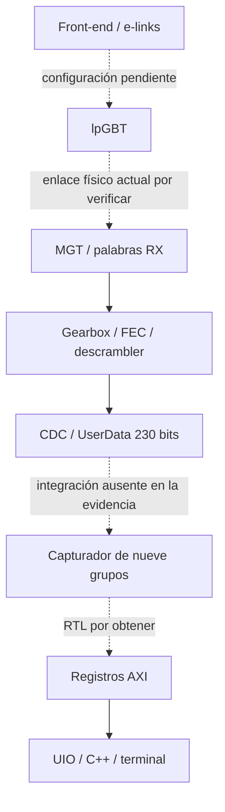
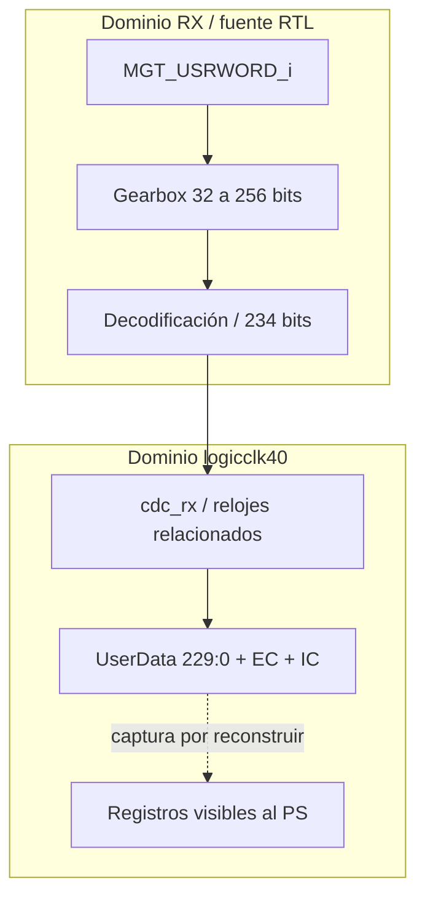
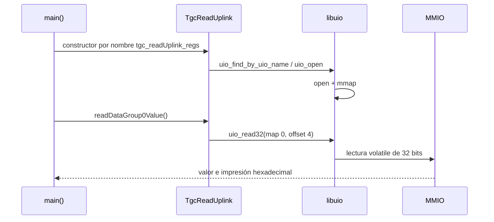
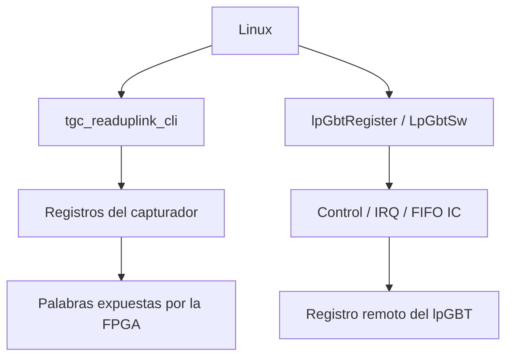
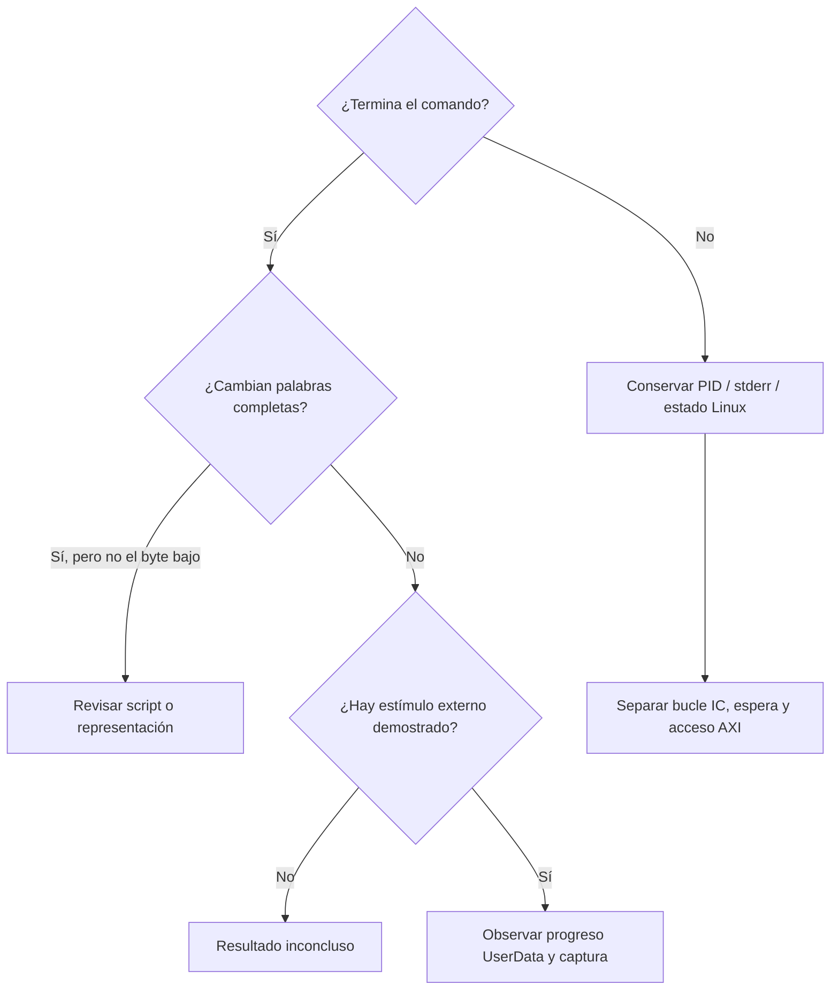
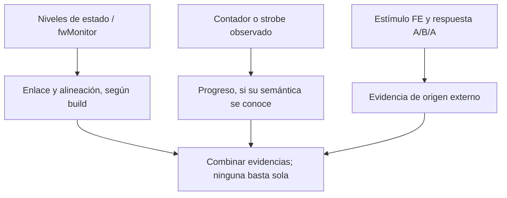
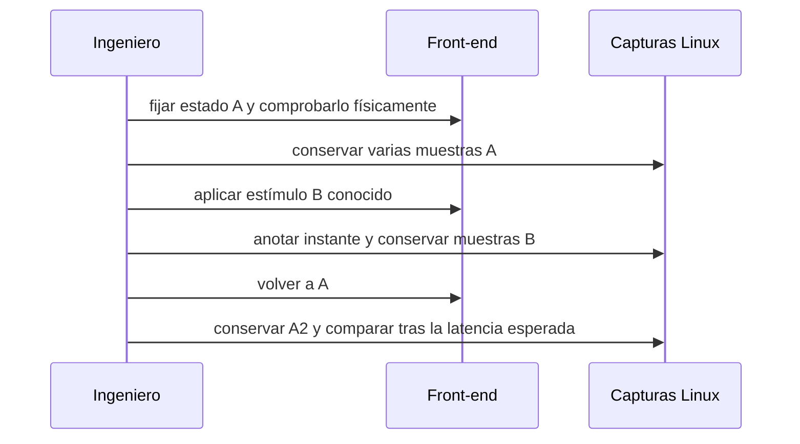
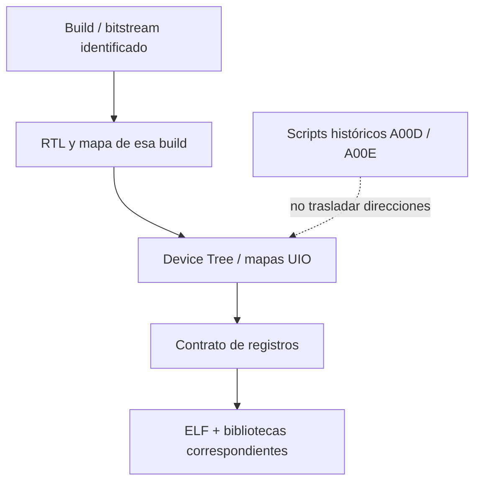

# EMP / lpGBT · guía de trabajo

**Objetivo:** leer datos del front-end y demostrar su origen. La recepción externa y el firmware activo siguen **DESCONOCIDOS**. Código recuperado y pruebas de loopback no bastan para validarlos.

## Leer datos

1. **Inventariar.** Identificar Linux, ELF, UIO y mapas. [P0 / A1–A2](00_GUIA_CAMPO.md#etapa-a1--inventario-de-linux-device-tree-y-firmware).
2. **Relacionar la build.** Verificar bitstream, Device Tree, offsets y efectos de lectura. [Compatibilidad](11_COMPATIBILIDAD.md).
3. **Leer con la CLI existente.** Solo después del punto de parada de P0. Conservar salida completa, stderr y retorno.
4. **Aplicar un estímulo externo A/B/A.** Documentar selección de origen y respuesta esperada. El mecanismo FE concreto aún falta.

Primer comando propuesto, desde la raíz del repositorio, en la Trenz. Solo inventario Linux:

```bash
python3 docs/recuperacion/diagnostico/atlas_diagnostico.py inventario --salida inventario_trenz.json
```

Lectura condicionada: `LECTOR` debe contener la ruta absoluta de la CLI validada; un solo lector y sin accesos pendientes. Requiere autorización y semántica del capturador confirmadas:

```bash
"$LECTOR" > muestra_A.out 2> muestra_A.err
rc=$?
printf 'RC=%s\n' "$rc"
```

**Esperado:** doce etiquetas completas: `magic`, nueve `data_group_N`, `data_header`, `clk_thresh`. Sin contador de frescura ni snapshot demostrado. Si no termina, conservar el proceso y detener nuevas lecturas. [Procedimiento completo y riesgos](00_GUIA_CAMPO.md#etapa-c--consultar-los-datos-expuestos-por-la-fpga).

## Arquitectura

**VERIFICADO / estático:** camino RX dentro del wrapper recuperado. **DESCONOCIDO:** selección actual de origen e integración del capturador de nueve grupos. Las flechas discontinuas marcan conexiones pendientes; no dibujan una recepción FE demostrada.



La clase C++ acredita el contrato de registros que espera el software; no demuestra que la build cargada lo implemente. [Mapa con fuentes](01_MAPA_TECNICO.md).

## Dominios de reloj

El gearbox trabaja con enable en el dominio RX. El CDC posterior transfiere 234 bits; el wrapper separa 230 bits de usuario, EC e IC. `ready` no cuenta eventos.



**VERIFICADO / estático:** wrapper/core/CDC. **DESCONOCIDO:** reloj y protocolo del capturador desplegado. No tratar este CDC como una FIFO asíncrona genérica. [Detalles y límites](10_BLOQUEO_LECTURAS.md#3-hallazgos-nuevos-en-rtl-y-software).

## De un comando a una lectura

La CLI recuperada no interpreta argumentos: incluso `--help` accede al hardware. Sus doce lecturas son independientes. **VERIFICADO / software**, extractos B01–B04.



La flecha de retorno resume la vuelta por las funciones. `open`/`mmap` correctos no garantizan respuesta AXI. [Recorrido completo](01_MAPA_TECNICO.md).

## Registros del lector

**Contrato C++ recuperado; hardware actual pendiente.** No usar esta tabla para explorar otra build.

| Registro | Offset | Qué sabemos |
|---|---|---|
| `magic` | `0x00` | Identificador esperado por la clase; valor de referencia actual pendiente |
| `data_group_0..8` | `0x04..0x24`, paso 4 | Nueve palabras de 32 bits; packing/frame y canal no cerrados |
| `data_header` | `0x28` | Semántica RTL por obtener; no asumir contador de eventos |
| `clk_thresh` | `0x2c` | Registro de temporización según tooling/notas; no barrer valores para diagnosticar |

No concatenar 288 bits como si fueran automáticamente el payload de 230 bits. [Catálogo y variantes](02_CATALOGO.md).

## Control del chip y payload

Son operaciones distintas. `lpGbtRegister -r` modifica el controlador IC y consume FIFO; no es una lectura pasiva del payload.



**VERIFICADO / implementación recuperada:** B01–B03, B06, B10. La integración hardware de cada build debe comprobarse. [Herramientas](02_CATALOGO.md).

## Cuando los valores se pegan

Primera pregunta: **¿el comando vuelve al prompt?** El reset que recuperaba el sistema no identifica por sí solo la pieza responsable.



**INFERIDO:** si la CLI termina con muestra repetida, captura/rearme y fuente merecen prioridad. **DESCONOCIDO:** causa histórica. [Análisis H1–H7](10_BLOQUEO_LECTURAS.md) y [script S0–S4](12_SCRIPT_DIAGNOSTICO.md).

## Qué mide cada indicador

| Observación | Acredita | No acredita |
|---|---|---|
| UIO aparece | Registro del dispositivo en Linux | IP compatible o respuesta AXI |
| `RX locked` | Estado de cabecera FPGA según debughub | Fuente FE, integridad o frescura |
| `XCVR Ready` | AND de ready TX/RX del MGT en el monitor | Eventos nuevos |
| Payload cambia | Diferencia entre accesos | Frame coherente u origen externo |
| Payload se repite | Igualdad de valores observados | Capturador detenido |



Los contadores/strobes requeridos no están expuestos por la CLI recuperada. La figura describe la prueba deseada, no instrumentación ya disponible. [Diagnóstico de enlace](00_GUIA_CAMPO.md#etapa-b--diagnosticar-el-enlace).

## Prueba externa A/B/A

**Propuesta condicionada:** confirmar reloj FE, cableado, selección de fuente, estímulo y retención esperada. El script anota intervenciones; no las ejecuta.



Cambios compatibles y reproducibles favorecen recepción externa. Si solo aparecen con loopback, FE sigue sin validarse. Repetir el ensayo y conservar configuración. [Condiciones e invalidaciones](00_GUIA_CAMPO.md#etapa-d--prueba-externa-aba).

## Incompatibilidades que importan



En el BD recuperado, `0xA00D0000` y `0xA00E0000` pertenecen a interrupt controllers; algunos scripts los usan como generador/lector. **CONTRADICTORIO entre versiones**, no prueba de dirección actual errónea. [Matriz de compatibilidad](11_COMPATIBILIDAD.md).

## Qué falta para cerrar la recuperación

- Identidad de build activa y RTL del capturador de nueve grupos.
- Packing de grupos, semántica de header, trigger/rearme y coherencia.
- Configuración efectiva FE/lpGBT, selección de origen y estímulo externo reproducible.
- Captura del fallo antes del reset y alcance exacto de la recuperación.

[Incertidumbres](04_INCERTIDUMBRES.md) · [Historia](03_HISTORIA.md) · [Auditoría](07_AUDITORIA.md) · [Fuentes](08_FUENTES.md). Las explicaciones son estáticas/históricas; no se ha operado el hardware desde esta investigación.
