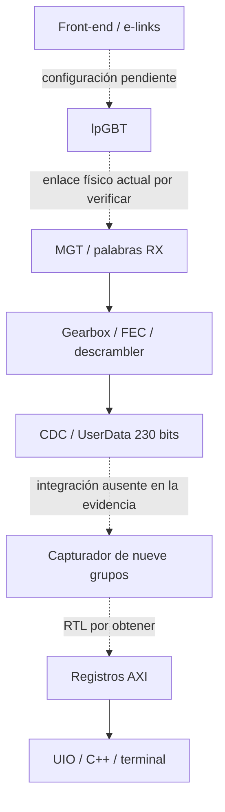
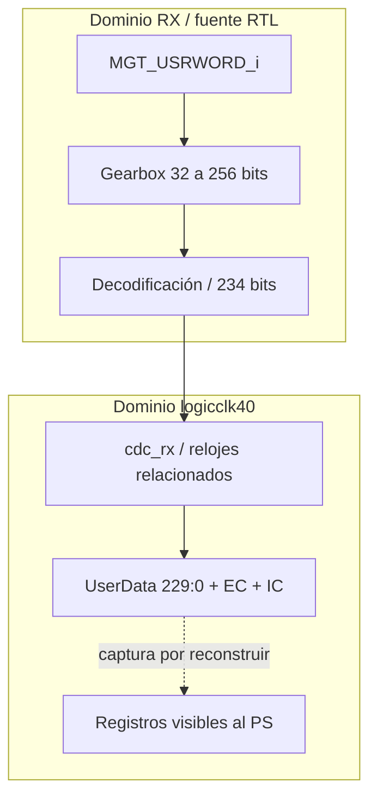
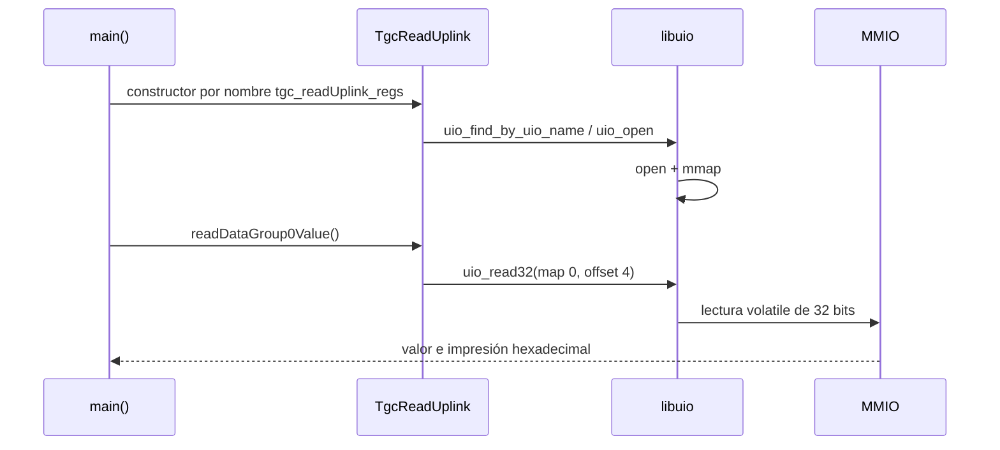
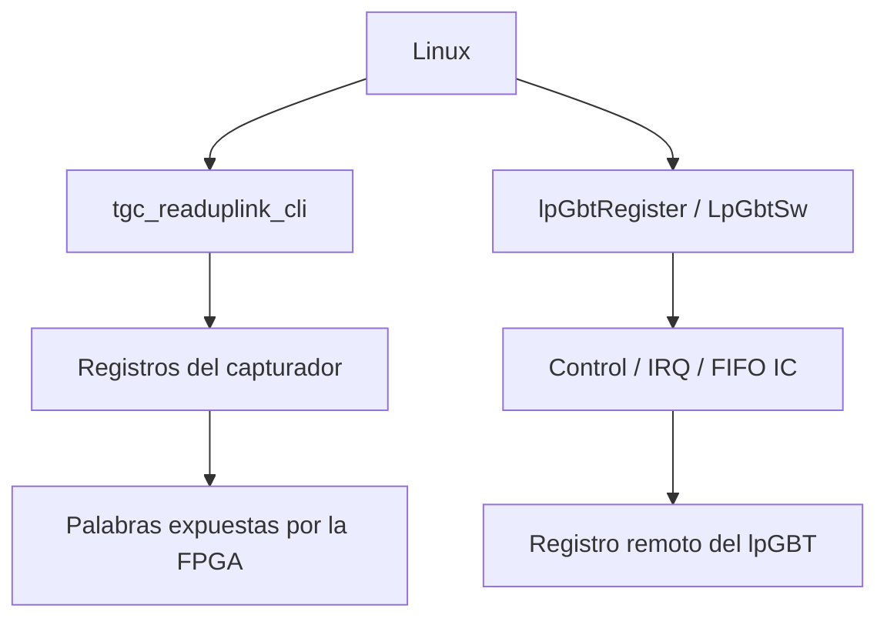
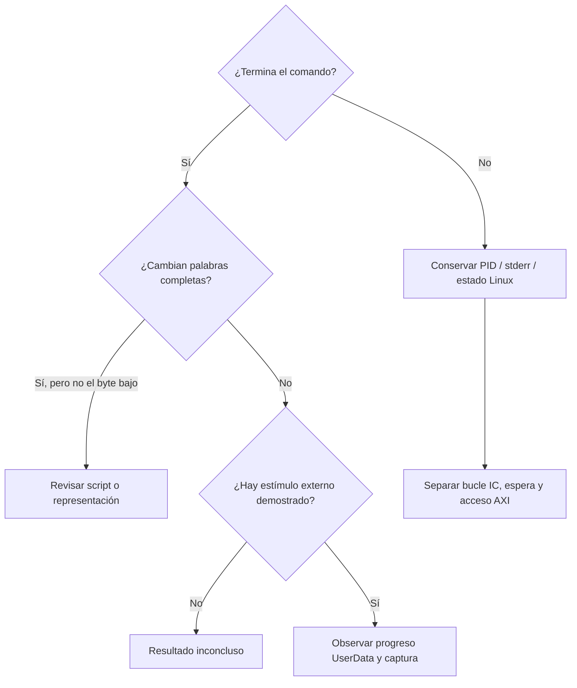
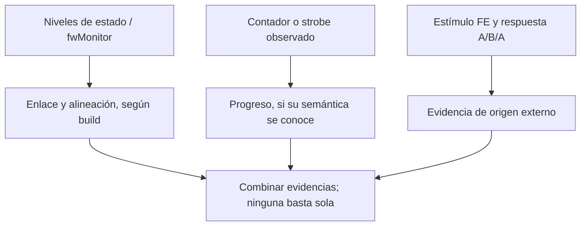
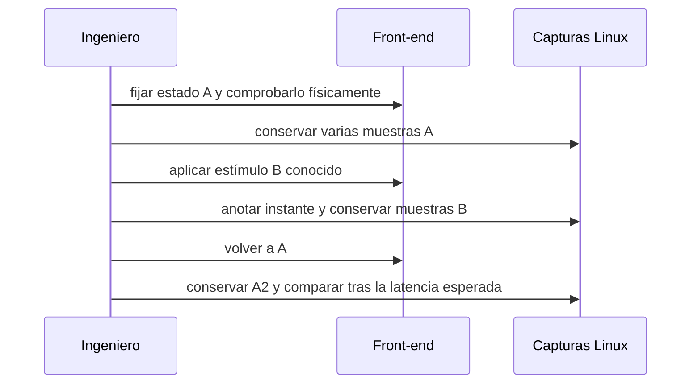
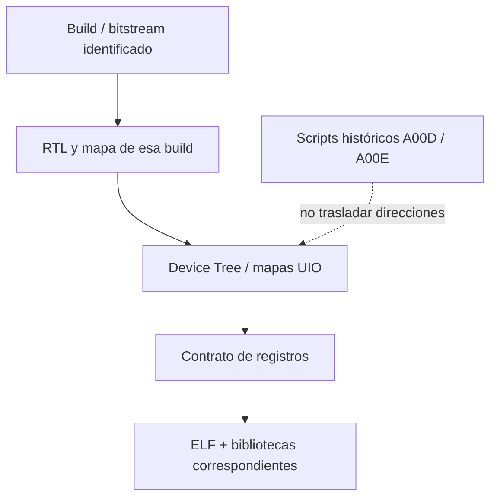

# EMP / lpGBT · guía de trabajo

La Trenz muestra los registros del EMP, y el enlace IC 10 respondió en la sesión del 19-11-2026. Para saber de dónde viene el payload falta la prueba con un estímulo conocido del front-end.

## Leer datos

Para diagnosticar, leer y guardar el CSV, usa la [guía de operación con emp](15_OPERAR_EMP.md). La [prueba A/B/A del front-end](00_GUIA_CAMPO.md#etapa-d-prueba-externa-aba) y el [procedimiento con la CLI anterior](00_GUIA_CAMPO.md#etapa-c-leer-los-datos-expuestos-por-la-fpga) están en la guía de campo.

## Arquitectura

El camino RX dentro del wrapper está comprobado en el código recuperado. No sabemos qué fuente está seleccionada hoy ni cómo se conecta el capturador de nueve grupos. Las flechas discontinuas son conexiones sin confirmar.

La clase C++ dice qué registros espera el software. Que la build cargada los tenga es otra cuestión. [Mapa con fuentes](01_MAPA_TECNICO.md).

## Dominios de reloj

El gearbox trabaja con un enable dentro del dominio RX. Después, el CDC pasa 234 bits, y el wrapper los separa en 230 bits de usuario, EC e IC. `ready` no cuenta eventos.

Wrapper, core y CDC están comprobados en el código. El reloj y el protocolo del capturador cargado son desconocidos. Este CDC no es una FIFO asíncrona cualquiera. [Detalles y límites](10_BLOQUEO_LECTURAS.md#3-hallazgos-nuevos-en-rtl-y-software).

## De un comando a una lectura

La CLI recuperada no lee argumentos, así que incluso `--help` accede al hardware. Hace doce lecturas independientes (extractos B01–B04).

La flecha de vuelta resume el retorno por las funciones. Que `open` y `mmap` funcionen no garantiza que AXI responda. [Recorrido completo](01_MAPA_TECNICO.md).

## Registros del lector

Esta tabla sale de la clase C++ recuperada. Falta comprobarla en el hardware actual, así que no la uses para explorar otra build.

| Registro | Offset | Qué sabemos |
|---|---|---|
| `magic` | `0x00` | Identificador que espera la clase. No conocemos su valor actual. |
| `data_group_0..8` | `0x04..0x24`, paso 4 | Nueve palabras de 32 bits. No sabemos el packing, el frame ni el canal. |
| `data_header` | `0x28` | Falta el RTL. No lo trates como contador de eventos. |
| `clk_thresh` | `0x2c` | Ajuste de temporización según las notas. No lo barras para diagnosticar. |

Las nueve palabras juntas son 288 bits. No las pegues como si fueran los 230 bits del payload. [Catálogo y variantes](02_CATALOGO.md).

## Control del chip y payload

Son dos caminos distintos. `lpGbtRegister -r` toca el controlador IC y vacía su FIFO, así que no es una lectura inocente del payload.

Comprobado en el código recuperado (B01–B03, B06, B10). En cada build hay que confirmar cómo está integrado en el hardware. [Herramientas](02_CATALOGO.md).

## Cuando los valores se pegan

Lo primero: ¿el comando vuelve al prompt? Que un reset lo arreglara no dice qué pieza fallaba.

Si la CLI termina pero repite la misma muestra, lo más probable es que haya que mirar la captura, el rearme y la fuente. La causa original sigue sin conocerse. [Hipótesis H1–H7](10_BLOQUEO_LECTURAS.md) y [script S0–S4](12_SCRIPT_DIAGNOSTICO.md).

## Qué mide cada indicador

| Observación | Qué te dice | Qué no te dice |
|---|---|---|
| Aparece el UIO | Linux registró el dispositivo | Si la IP es compatible o si AXI responde |
| `RX locked` | La FPGA encontró la cabecera (debughub) | De dónde viene el dato, si está íntegro o si es nuevo |
| `XCVR Ready` | AND de ready TX y RX del MGT | Si llegan eventos nuevos |
| El payload cambia | Hay diferencia entre dos lecturas | Si es un frame coherente o viene de fuera |
| El payload se repite | Los valores leídos son iguales | Si el capturador está detenido |

La CLI recuperada no muestra contadores ni strobes. La figura describe la prueba que querríamos hacer, con instrumentos que todavía no hay. [Diagnóstico de enlace](00_GUIA_CAMPO.md#etapa-b-diagnosticar-el-enlace).

## Prueba externa A/B/A

Antes de hacerla hay que confirmar el reloj del FE, el cableado, la fuente seleccionada, el estímulo y cuánto retiene la captura. El script solo anota los cambios; no los hace.

Si los cambios siguen al estímulo y se repiten, eso apunta a recepción externa. Si solo aparecen con loopback, el FE sigue sin probarse. Repite la prueba y guarda la configuración. [Condiciones y qué la invalida](00_GUIA_CAMPO.md#etapa-d-prueba-externa-aba).

## Incompatibilidades que importan

En el BD recuperado, `0xA00D0000` y `0xA00E0000` son interrupt controllers, pero algunos scripts los usan como generador y lector. Son versiones distintas que se contradicen. Esto no prueba que la dirección actual esté mal. [Tabla de compatibilidad](11_COMPATIBILIDAD.md).

## Qué falta para cerrar la recuperación

- Qué build está cargada y el RTL del capturador de nueve grupos.
- Packing de los grupos, significado del header, trigger, rearme y coherencia.
- Configuración real del FE y del lpGBT, fuente seleccionada y un estímulo externo repetible.
- Captura del fallo antes del reset y qué se reinicia exactamente.

[Incertidumbres](04_INCERTIDUMBRES.md) · [Historia](03_HISTORIA.md) · [Auditoría](07_AUDITORIA.md) · [Fuentes](08_FUENTES.md). Todo esto sale del código y de las notas; esta investigación no operó el hardware.
